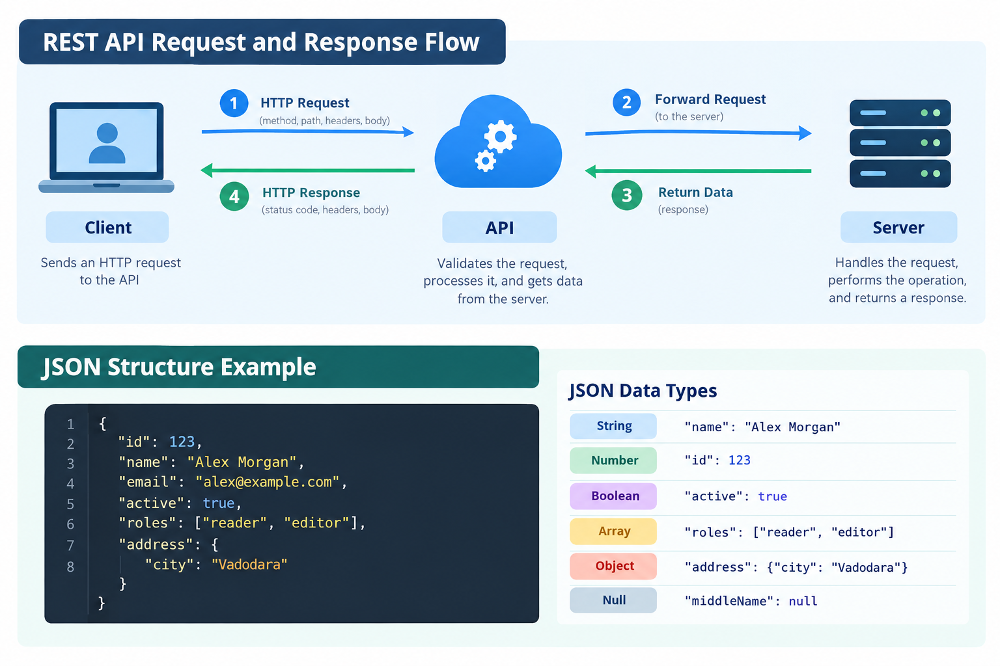

# REST API Reference

This guide explains HTTP methods, request and response structures, JSON data types, and HTTP status codes used in REST APIs.

## On This Page

- [HTTP Methods](#http-methods)
- [Request Structure](#request-structure)
- [Response Structure](#response-structure)
- [HTTP Status Codes](#http-status-codes)
- [Related Guides](#related-guides)

---

## HTTP Methods

HTTP methods tell an API what action a client wants to perform on a resource.

| Method | Purpose | Example |
|---|---|---|
| `GET` | Retrieve data | Get a user's details |
| `POST` | Create a resource or submit data | Create a new user |
| `PUT` | Replace an existing resource | Replace a user's details |
| `PATCH` | Update part of a resource | Change a user's email |
| `DELETE` | Remove a resource | Delete a user |
| `HEAD` | Retrieve response headers without the response body | Check resource metadata |
| `OPTIONS` | Discover supported communication options | Check allowed HTTP methods |

### Example: GET Request

```http
GET /users/123 HTTP/1.1
Host: api.example.com
Accept: application/json
```

This request asks the API to return information about the user with ID `123`.

---

## Request Structure

An HTTP request contains information that tells the API which resource to access and what action to perform.

Common request components include:

| Component | Description |
|---|---|
| Method | Specifies the action, such as `GET` or `POST` |
| Endpoint | Identifies the resource being accessed |
| Headers | Provide additional information about the request |
| Body | Contains data sent to the API, commonly with `POST`, `PUT`, or `PATCH` |

### Example: POST Request

```http
POST /users HTTP/1.1
Host: api.example.com
Content-Type: application/json
Accept: application/json
```

Request body:

```json
{
  "name": "Alex Morgan",
  "email": "alex@example.com"
}
```

The client sends this request to submit new user information. The API validates the data and processes the request according to its rules.

### Request and Response Flow



*Figure 1: REST API request and response flow, with an example of JSON structure and data types.*

---

## Response Structure

An HTTP response tells the client what happened after the API processed a request.

A response commonly includes:

| Component | Description |
|---|---|
| Status code | Indicates the result of the request |
| Headers | Provide metadata about the response |
| Body | Contains returned data or an error message, when applicable |

### Example: Successful Response

```http
HTTP/1.1 200 OK
Content-Type: application/json
```

Response body:

```json
{
  "id": 123,
  "name": "Alex Morgan",
  "email": "alex@example.com",
  "active": true
}
```

The response returns the user's details as a JSON object.

### Common JSON Data Types

JSON is a format commonly used to exchange data between clients and APIs.

| Data type | Example | Description |
|---|---|---|
| String | `"name": "Alex Morgan"` | Text enclosed in double quotes |
| Number | `"id": 123` | A numeric value |
| Boolean | `"active": true` | A `true` or `false` value |
| Array | `"roles": ["reader", "editor"]` | An ordered list of values |
| Object | `"address": {"city": "Vadodara"}` | A collection of key-value pairs |
| Null | `"middleName": null` | Represents the absence of a value |

---

## HTTP Status Codes

HTTP status codes indicate whether a request was successful, needs further action, or failed.

### Status Code Categories

| Range | Category | Meaning |
|---|---|---|
| `1xx` | Informational | The request is being processed |
| `2xx` | Success | The request was received and handled successfully |
| `3xx` | Redirection | Further action is needed to complete the request |
| `4xx` | Client error | Something is wrong with the request |
| `5xx` | Server error | The server failed to complete a valid request |

### Common Status Codes

| Code | Meaning | When it occurs |
|---|---|---|
| `200 OK` | Success | The request completed successfully |
| `201 Created` | Resource created | A new resource was created |
| `204 No Content` | Success without a response body | The request succeeded and no body is returned |
| `400 Bad Request` | Invalid request | The request contains invalid or missing information |
| `401 Unauthorized` | Authentication required or failed | Valid authentication credentials are missing or not accepted |
| `403 Forbidden` | Access denied | The client is not allowed to access the resource |
| `404 Not Found` | Resource not found | The requested resource does not exist or is unavailable |
| `429 Too Many Requests` | Rate limit exceeded | Too many requests were sent in a given period |
| `500 Internal Server Error` | Server error | The server encountered an unexpected problem |
| `503 Service Unavailable` | Service unavailable | The server cannot currently handle the request |

### Troubleshooting Status Codes

- **400:** Check the request body, required fields, and parameter formats.
- **401:** Check the authentication credentials or token.
- **403:** Confirm that the account has permission to access the resource.
- **404:** Verify the endpoint URL and resource ID.
- **429:** Reduce the request rate and follow any rate-limit guidance.
- **5xx:** Retry when appropriate and check the API's service status or error details.

---

## Related Guides

- [Getting Started with REST APIs](getting-started.md) — Learn API fundamentals and how requests work.
- [Security and Troubleshooting](security-and-troubleshooting.md) — Learn about authentication, credential safety, and common API errors.
- [Project Overview](README.md) — Explore the documentation and how to use it.

## Additional Resources

- [HTTP Semantics — RFC 9110](https://www.rfc-editor.org/rfc/rfc9110)
- [JSON Official Website](https://www.json.org/)
